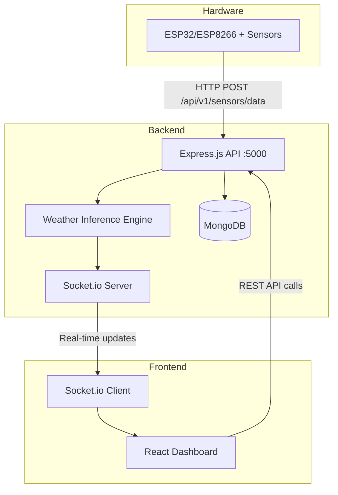

# IoT Weather & Environmental Dashboard — Implementation Plan

A full-stack IoT weather dashboard with NodeMCU firmware, Express.js backend, MongoDB persistence, real-time WebSocket streaming, weather inference engine, and an animated React frontend.

## User Review Required

> [!IMPORTANT]
> **Tailwind CSS Version:** You requested Tailwind CSS. I'll use **Tailwind CSS v3** with PostCSS (the stable, well-supported version). Confirm if you prefer v4.

> [!IMPORTANT]
> **MongoDB Requirement:** The backend expects a running MongoDB instance at `localhost:27017`. Ensure MongoDB is installed and running before starting the server.

> [!WARNING]
> **JWT Secret:** A placeholder `JWT_SECRET` will be generated in `.env`. Replace it with a cryptographically secure value in production.

## Open Questions

> [!IMPORTANT]
> **Sensor Hardware:** The firmware supports BME280, SCD41, LTR390, and an anemometer. Do you have all these sensors, or should I include mock/simulated data modes for missing hardware?

> [!IMPORTANT]
> **Initial Admin Account:** Should the server seed a default admin user on first startup (e.g., `admin@weather.local` / `admin123`), or do you prefer a CLI-based setup script?

## Architecture Overview



---

## Proposed Changes

### Phase 1: Database Schemas & Row-Level Security Auth

Core backend infrastructure — MongoDB connection, Mongoose models, JWT authentication, and admin management routes.

---

#### [NEW] [.env](file:///e:/Weather_Dashboard/server/.env)
- `PORT=5000`, `MONGODB_URI`, `JWT_SECRET`, `JWT_EXPIRES_IN`

#### [NEW] [package.json](file:///e:/Weather_Dashboard/server/package.json)
- Express, Mongoose, Socket.io, jsonwebtoken, bcryptjs, cors, dotenv, helmet, express-rate-limit

#### [NEW] [server.js](file:///e:/Weather_Dashboard/server/server.js)
- Express app entry point, MongoDB connection, middleware stack, route mounting, Socket.io setup

#### [NEW] [config/db.js](file:///e:/Weather_Dashboard/server/config/db.js)
- Mongoose connection with production/test URI switching via `NODE_ENV`

#### [NEW] Models
- [User.js](file:///e:/Weather_Dashboard/server/models/User.js) — `email`, `password` (bcrypt hashed), `role` (admin/user), `assignedSites[]`, timestamps
- [Site.js](file:///e:/Weather_Dashboard/server/models/Site.js) — `name`, `location` (lat/lng/address), `description`, `createdBy`, `apiKey`, timestamps
- [Sensor.js](file:///e:/Weather_Dashboard/server/models/Sensor.js) — `siteId`, `type` (bme280/scd41/ltr390/anemometer), `status`, `lastPing`, `metadata`
- [Reading.js](file:///e:/Weather_Dashboard/server/models/Reading.js) — `siteId`, `sensorId`, `type`, `data` (flexible schema for different sensor payloads), `timestamp`, indexed for time-series queries

#### [NEW] Middleware
- [auth.js](file:///e:/Weather_Dashboard/server/middleware/auth.js) — JWT verification, `protect` and `authorize('admin')` middleware
- [siteAccess.js](file:///e:/Weather_Dashboard/server/middleware/siteAccess.js) — Row-level security: users can only access data for their `assignedSites`

#### [NEW] Routes & Controllers
- [authRoutes.js](file:///e:/Weather_Dashboard/server/routes/authRoutes.js) / [authController.js](file:///e:/Weather_Dashboard/server/controllers/authController.js) — `POST /register`, `POST /login`, `GET /me`
- [adminRoutes.js](file:///e:/Weather_Dashboard/server/routes/adminRoutes.js) / [adminController.js](file:///e:/Weather_Dashboard/server/controllers/adminController.js) — CRUD users, CRUD sites, assign sites to users

---

### Phase 2: Ingestion API & Sensor Diagnostics

Secure sensor data ingestion endpoint and diagnostic health-check routes.

---

#### [NEW] Middleware
- [deviceAuth.js](file:///e:/Weather_Dashboard/server/middleware/deviceAuth.js) — Validates `X-Device-API-Key` header against `Site.apiKey`

#### [NEW] Routes & Controllers
- [sensorRoutes.js](file:///e:/Weather_Dashboard/server/routes/sensorRoutes.js) / [sensorController.js](file:///e:/Weather_Dashboard/server/controllers/sensorController.js)
  - `POST /api/v1/sensors/data` — Ingests JSON payload, creates/updates Sensor record, stores Reading
  - `GET /api/v1/sensors/status` — Returns per-sensor health: last ping, online/offline (offline if >60s since last ping), latency

---

### Phase 3: Weather Inference Engine & WebSocket Filtering

Smart broadcasting logic and weather condition detection.

---

#### [NEW] [services/weatherInference.js](file:///e:/Weather_Dashboard/server/services/weatherInference.js)
- Algorithm analyzing temp, humidity, CO2, UV, wind speed to infer: `Clear/Sunny`, `Cloudy`, `Rainy`, `Fog/Mist`, `Hailstorm/Severe Storm`, `Smog`
- Configurable thresholds

#### [NEW] [services/broadcastFilter.js](file:///e:/Weather_Dashboard/server/services/broadcastFilter.js)
- Stores last-broadcast values per site
- Only emits Socket.io events when: temp changes ≥1°C, humidity ≥2%, CO2 ≥50ppm, UV ≥0.5, wind ≥2 km/h

#### [MODIFY] [server.js](file:///e:/Weather_Dashboard/server/server.js)
- Integrate Socket.io room-based broadcasting (one room per siteId)
- Wire inference engine into the ingestion pipeline

---

### Phase 4: NodeMCU ESP32 / ESP8266 Firmware

Complete Arduino/PlatformIO firmware.

---

#### [NEW] [firmware/config.h](file:///e:/Weather_Dashboard/firmware/config.h)
- `WIFI_SSID`, `WIFI_PASSWORD`, `SERVER_IP`, `SERVER_PORT`, `SITE_ID`, `DEVICE_API_KEY`
- I2C pin definitions, anemometer interrupt pin

#### [NEW] [firmware/weather_station.ino](file:///e:/Weather_Dashboard/firmware/weather_station.ino)
- Wi-Fi connect/reconnect with exponential backoff
- Sensor initialization: BME280 (I2C), SCD41 (I2C), LTR390 (I2C), Anemometer (interrupt-based)
- JSON payload construction using ArduinoJson
- HTTP POST to `/api/v1/sensors/data` with retry logic (3 attempts)
- Deep sleep / loop interval configuration

---

### Phase 5: React Dashboard Core & Site Selector

Frontend scaffolding with auth, admin management, and site selection.

---

#### [NEW] React App (`client/`)
- Vite + React + Tailwind CSS v3 + Framer Motion + React Router v6 + Axios + Socket.io-client

#### [NEW] Core Pages & Components
- `LoginPage.jsx` — Glassmorphic login form with animated background
- `AdminDashboard.jsx` — User management, site creation, site assignment panels
- `SiteSelector.jsx` — Dropdown/card selector filtered by user's assigned sites
- `ProtectedRoute.jsx` — Auth guard with role checking
- `api/axios.js` — Configured Axios instance with JWT interceptor
- `context/AuthContext.jsx` — Auth state management

---

### Phase 6: Animated Weather Dashboard & Diagnostics

The showcase — real-time animated weather visualization.

---

#### [NEW] Dashboard Components
- `WeatherDashboard.jsx` — Main layout with gauge cards, time-series charts (Recharts), weather condition display
- `AnimatedBackground.jsx` — Dynamic weather-themed backgrounds (sun rays, rain particles, fog mist, storm lightning) using CSS animations + Framer Motion
- `GaugeCard.jsx` — Glassmorphic cards with animated circular gauges for temp, humidity, CO2, UV, wind
- `WeatherConditionBadge.jsx` — Animated badge showing inferred weather state
- `DiagnosticsPanel.jsx` — Real-time sensor health: online/offline indicators, last ping, latency bars
- `TimeSeriesChart.jsx` — Interactive time-series with zoom/pan for historical data
- `hooks/useSocket.js` — Socket.io hook managing room subscriptions per site

---

## Project Structure

```
e:/Weather_Dashboard/
├── server/                          # Express.js Backend
│   ├── .env
│   ├── package.json
│   ├── server.js
│   ├── config/
│   │   └── db.js
│   ├── models/
│   │   ├── User.js
│   │   ├── Site.js
│   │   ├── Sensor.js
│   │   └── Reading.js
│   ├── middleware/
│   │   ├── auth.js
│   │   ├── siteAccess.js
│   │   └── deviceAuth.js
│   ├── controllers/
│   │   ├── authController.js
│   │   ├── adminController.js
│   │   └── sensorController.js
│   ├── routes/
│   │   ├── authRoutes.js
│   │   ├── adminRoutes.js
│   │   └── sensorRoutes.js
│   └── services/
│       ├── weatherInference.js
│       └── broadcastFilter.js
├── client/                          # React Frontend
│   ├── package.json
│   ├── vite.config.js
│   ├── tailwind.config.js
│   ├── postcss.config.js
│   ├── index.html
│   ├── src/
│   │   ├── main.jsx
│   │   ├── App.jsx
│   │   ├── index.css
│   │   ├── api/
│   │   │   └── axios.js
│   │   ├── context/
│   │   │   └── AuthContext.jsx
│   │   ├── components/
│   │   │   ├── ProtectedRoute.jsx
│   │   │   ├── SiteSelector.jsx
│   │   │   ├── GaugeCard.jsx
│   │   │   ├── WeatherConditionBadge.jsx
│   │   │   ├── AnimatedBackground.jsx
│   │   │   ├── DiagnosticsPanel.jsx
│   │   │   └── TimeSeriesChart.jsx
│   │   ├── pages/
│   │   │   ├── LoginPage.jsx
│   │   │   ├── AdminDashboard.jsx
│   │   │   └── WeatherDashboard.jsx
│   │   └── hooks/
│   │       └── useSocket.js
│   └── public/
└── firmware/                        # ESP32/ESP8266 Firmware
    ├── config.h
    └── weather_station.ino
```

---

## Verification Plan

### Automated Tests
```bash
# Backend: Install dependencies and start server
cd e:/Weather_Dashboard/server && npm install && npm run dev

# Frontend: Install dependencies and start dev server
cd e:/Weather_Dashboard/client && npm install && npm run dev
```

### Manual Verification
1. **Backend Health:** `curl http://localhost:5000/api/v1/health` returns 200
2. **Auth Flow:** Register admin → Login → Get JWT → Access protected routes
3. **Sensor Ingestion:** Simulate POST to `/api/v1/sensors/data` with sample JSON payload
4. **WebSocket:** Verify real-time updates appear on the React dashboard when sensor data is posted
5. **Firmware:** Compile in Arduino IDE / PlatformIO for ESP32 and ESP8266 targets
6. **Weather Inference:** POST varying sensor data and verify inferred weather conditions change correctly
